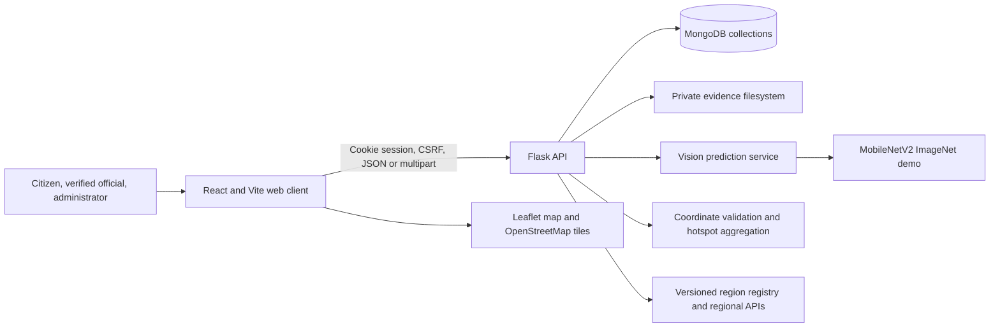

<div align="center">

# NODAL

### Connecting the systems that matter.

**An AI-Powered Public Infrastructure Intelligence and Civic Complaint Management Platform**

Designed for Indian cities, with **Bengaluru as the initial pilot**.

[](https://react.dev/)
[](https://vite.dev/)
[](https://flask.palletsprojects.com/)
[](https://www.mongodb.com/)
[](https://leafletjs.com/)

[About](#about) · [Features](#key-features) · [Architecture](#system-architecture) · [Setup](#local-installation-and-setup) · [Limitations](#current-limitations)

[Source repository](https://github.com/itznothh/NODAL) · [Contact](mailto:nodalcontactdesk@gmail.com)

</div>

---

## About

Public infrastructure complaints can be difficult to route, track and review consistently. NODAL provides a shared workflow where citizens can report an issue with a description and location, administrators can manage routing and assignments, and authorized officials can record progress for review.

NODAL is intended as an **India-wide platform**. Bengaluru is the initial pilot context, not the platform's geographic limit. The current city selector is a map-navigation control; it does not make platform-wide complaint data city-specific. Regional statistics are available only when an approved region boundary exists.

The platform is a software project and is **not a government service or an integration with a government grievance system**. A complaint record is not independently verified merely because it appears in NODAL.

## Key features

- **Citizen accounts:** public registration creates citizen accounts; users can maintain a profile and access their own complaints.
- **Complaint reporting and tracking:** submit a category, description and map-selected location, then follow status and assignment history.
- **Image-assisted reporting:** request an image prediction before submission. Predictions are advisory and do not submit, assign or resolve a complaint.
- **Department routing:** active category mappings can suggest a department. Suggestion is recorded separately from an administrator's actual assignment.
- **Controlled lifecycle:** officials submit progress and resolutions; an administrator reviews submitted resolutions. Citizens can dispute an incorrect resolution through the supported workflow.
- **Official workbench:** verified officials see work permitted by their individual assignment or authorized department scope.
- **Administration:** administrators review official-access requests, manage departments, assign work and review resolutions.
- **Protected evidence:** image files are stored outside MongoDB with generated names and retrieved through ownership and role checks.
- **Maps and hotspots:** Leaflet displays complaint locations and aggregate hotspot information. Public hotspot responses do not return individual complaint records.
- **Region-aware API foundation:** versioned region records and regional overview/hotspot endpoints exist, but a region must have an approved boundary before it can return regional statistics.

## Screenshots

There are currently **no verified screenshots of the running application** in the repository. The available PNGs are source artwork and report diagrams, not application captures. Add genuine screenshots here after capturing the current application with synthetic or otherwise approved test data. Do not include credentials, private user data or production records.

Suggested captures: landing page, login/registration, citizen dashboard and report form, official workbench, administrator dashboard and department registry, and responsive mobile views.

## Technology stack

| Layer | Technologies confirmed in the repository |
| --- | --- |
| Frontend | React, Vite, JavaScript and CSS |
| Maps and icons | Leaflet, React-Leaflet, OpenStreetMap tiles and Lucide React |
| Backend | Python, Flask, Flask-CORS and PyMongo |
| Database | MongoDB |
| Image inference | TensorFlow/Keras, MobileNetV2 and Pillow |
| Text and spatial utilities | scikit-learn, including TF-IDF/logistic-regression utilities and DBSCAN |
| Production WSGI | Waitress |

The project uses plain CSS; Tailwind CSS and Firebase are not part of the inspected implementation.

## System architecture



The frontend uses credentialed requests and CSRF tokens for state-changing operations. Flask enforces role, ownership, official verification and assignment scope. MongoDB stores complaint and metadata records; evidence bytes are kept in a private filesystem directory configured by `NODAL_EVIDENCE_DIR`. The current image-prediction path is distinct from complaint submission and does not automatically act on predictions.

Public `/public/overview` and `/hotspots` are platform-wide. Regional endpoints use approved region boundaries; they do not infer Bengaluru membership from a map centre or proximity alone.

## Project structure

```text
NODAL/
├── backend/                 Flask application, authorization, APIs and tests
│   ├── api/                 Vision API blueprint
│   ├── services/            Vision inference service
│   └── tests/               Backend and operational-safety tests
├── frontend/                React/Vite application and static assets
│   └── src/                 Portals, API client, maps and styles
├── ml/                      Text-classifier helper and vision workflow
│   └── vision/               Dataset preparation, training, evaluation and tests
├── docs/                     Setup, deployment, security and workflow guides
├── scripts/                  Local launcher helpers and showcase preparation
├── project_report/           NODAL academic report and its supporting diagrams
├── START_NODAL.bat           Local isolated-demo startup
└── STOP_NODAL.bat            Stops only launcher-owned application processes
```

## Local installation and setup

### Prerequisites

- Windows for the supplied `.bat` launcher; manual development can be adapted to other platforms.
- Python and Node.js/npm versions compatible with the pinned project dependencies.
- MongoDB running locally at `127.0.0.1:27017` for the supplied launcher.
- A project-root `.venv-vision` environment and installed frontend dependencies for the one-click launcher.

### Install dependencies

From the repository root in PowerShell:

```powershell
py -m venv .venv-vision
.\.venv-vision\Scripts\python.exe -m pip install -r requirements-before-vision.txt
.\.venv-vision\Scripts\python.exe -m pip install -r ml/vision/requirements-vision.txt
Set-Location frontend
npm ci
Set-Location ..
```

TensorFlow wheels depend on the Python/platform combination. Use a Python version supported by the pinned dependencies and verify the vision installation before relying on image prediction.

### Safe environment configuration

For manual local development, copy `.env.example` to `.env`, keep `NODAL_DB_NAME=nodal_dev`, and replace the placeholder `NODAL_SECRET_KEY` with a fresh private value. `.env` is ignored by Git; only `.env.example` is intended for version control. Never point local development or tests at the production database named `nodal`.

The tracked example includes the configuration variables used by the backend:

| Variable | Local purpose |
| --- | --- |
| `MONGO_URI` | Local MongoDB connection URI |
| `NODAL_ENV` | Runtime mode; use `development` locally |
| `NODAL_SECRET_KEY` | Private session-signing secret; replace the placeholder locally |
| `NODAL_DB_NAME` | Manual development database; use `nodal_dev` |
| `NODAL_AUDIT_MODE` | Audit safety mode; the one-click launcher sets this for its isolated database |
| `NODAL_CORS_ORIGINS` | Exact local frontend origins |
| `NODAL_EVIDENCE_DIR` | Optional private evidence directory outside the repository |

Do not commit `.env`, passwords, generated credentials, database exports, user uploads or evidence.

### One-click isolated demo

Start MongoDB, then run from the project root:

```powershell
.\START_NODAL.bat
```

The launcher checks MongoDB and ports 5000/5174, starts Flask and Vite in separate windows, waits for their HTTP responses and opens `http://127.0.0.1:5174`. It uses `.venv-vision`, the existing `frontend/node_modules`, and the **isolated** `nodal_phase8_audit` database with process-local audit settings. It does not run seed, bootstrap or migration scripts. On the first backend request, normal startup may create indexes and default department registry entries in that isolated database.

Stop only launcher-owned application processes with:

```powershell
.\STOP_NODAL.bat
```

MongoDB is intentionally left running. The launcher does not create demo accounts or complaints. Follow [the local demo guide](docs/LOCAL_DEMO_SETUP.md) and [showcase setup notes](docs/PHASE8_SHOWCASE_SETUP.md) for any separately authorized data preparation. The showcase utility is not a general-purpose seed command.

### Manual development

Use a separate shell for each service. First ensure `.env` targets `nodal_dev` and MongoDB is local. Then start the backend from the project root:

```powershell
$env:NODAL_ENV = 'development'
$env:NODAL_AUDIT_MODE = 'false'
$env:NODAL_DB_NAME = 'nodal_dev'
$env:MONGO_URI = 'mongodb://127.0.0.1:27017'
$env:NODAL_SECRET_KEY = & .\.venv-vision\Scripts\python.exe -c "import secrets; print(secrets.token_urlsafe(48))"
& .\.venv-vision\Scripts\python.exe -m flask --app backend.app:app run --host 127.0.0.1 --port 5000 --no-debugger --no-reload
```

In another shell:

```powershell
Set-Location frontend
$env:VITE_API_BASE = 'http://127.0.0.1:5000'
npm run dev -- --host 127.0.0.1 --port 5174 --strictPort
```

Open `http://127.0.0.1:5174`. Keep the generated secret in the process environment only; do not paste it into source, documentation or chat. For production, follow [DEPLOYMENT.md](docs/DEPLOYMENT.md), which requires explicit secure configuration and a WSGI server.

## Demo information

Records created for local showcase purposes are **synthetic demonstration data**, not verified civic complaints. Do not present them as real incidents, validated statistics or government activity. The launcher does not create them, and no demo credentials are published in this repository. Official access remains pending until the existing administrator-led independent verification workflow is completed; synthetic applicants must not be represented as real verified officials.

## Security and access control

- Public registration creates citizen accounts only; it does not offer public official or administrator role selection.
- Official routes require an authenticated, active official account with independent administrator verification. Department and individual assignment scopes are also enforced by the backend.
- Citizens can access their own complaints and permitted evidence, not other users’ records.
- Administrators manage verification, assignment and resolution decisions through protected routes.
- Mutating API requests use CSRF protection with cookie-based sessions.
- Evidence access is protected by complaint ownership and authorized official/administrator checks; evidence files are stored outside MongoDB.
- Keep local environment files, credentials, database dumps and private evidence outside Git. The repository’s `.gitignore` excludes these classes of files.

## AI/ML limitations

The currently integrated MobileNetV2 model uses ImageNet labels for **general image recognition**. It is not a trained civic issue classifier and must not be described as detecting potholes, flooding or other civic defects. Predictions are advisory and require user confirmation; they do not submit or route a complaint automatically.

A separate civic-image training pipeline exists under `ml/vision/`, including dataset checks, shared preprocessing, training, evaluation and threshold configuration. However, a curated civic dataset and validated civic model artifacts are not included. No civic classification accuracy or real-world diagnosis claim is supported.

The text-classifier artifact `ml/classifier.joblib` is excluded until its training-data provenance is reviewed. The current `ml/train_classifier.py` reads from the hard-coded `nodal` database; **do not run it as-is**. See [the artifact provenance note](docs/ML_CLASSIFIER_ARTIFACT.md). If the artifact is absent, the backend category helper falls back to `unclassified`.

## Geographic intelligence limitations

The application includes coordinate validation, platform-wide hotspot aggregation, a versioned region registry and region-scoped overview/hotspot endpoints. Regional statistics require an approved boundary. The Greater Bengaluru Area record remains an unapproved draft with no boundary geometry, so it does not provide GBA complaint statistics. No official geographic coverage should be inferred from map navigation or coordinates alone.

Hotspot output is an aggregate snapshot, not a live government feed or a historical trend. Sparse-result suppression and coarsened cluster centers reduce direct exposure but do not provide a formal anonymity guarantee.

## Current development status

| Capability | Status based on repository implementation |
| --- | --- |
| Citizen, official and admin portals | Implemented in frontend and Flask API; official access depends on independent verification |
| Complaint lifecycle and assignment history | Implemented with server-side transition and role checks |
| Department registry and category suggestions | Implemented; prototype mappings are not verified government jurisdiction assignments |
| Evidence upload and protected retrieval | Implemented; deployment must provide persistent private storage and backups |
| ImageNet prediction demo | Implemented as generic image recognition |
| Civic vision training workflow | Code exists; curated dataset and validated model artifacts are not available in the repository |
| Platform-wide map and hotspot APIs | Implemented; data is not city-scoped by the map selector |
| Region-aware API architecture | Implemented; requires approved region geometry to return regional metrics |
| Greater Bengaluru Area statistics | Pending; boundary and redistribution provenance are unresolved |
| Live government feeds, official contacts and SLAs | Not implemented or verified |
| Public production deployment | Not established by this repository |

The repository includes backend and vision automated tests plus frontend lint/build scripts. Passing automated tests does not by itself establish production readiness, civic-model accuracy or live government integration.

## Future scope

- Curate, license and independently label a representative civic image dataset; validate model calibration and real-world performance.
- Obtain and verify authoritative geographic boundaries and redistribution rights before activating city/ward statistics.
- Extend region support to other Indian cities and administrative areas using approved boundary versions.
- Add administrator-verified public department contact information when a reviewed backend/API design exists.
- Add configurable **indicative** resolution estimates with clear provenance and disclaimers; do not present them as government commitments or SLAs.
- Connect to verified civic data sources only through authorized agreements and documented privacy controls.
- Conduct operational accessibility, privacy, reliability and performance reviews before deployment.

## Academic information

**Institution:** M. S. Ramaiah Institute of Technology, Bengaluru  
**Department:** Artificial Intelligence and Machine Learning (AIML)  
**Degree:** Bachelor of Engineering (B.E.)  
**Academic year:** [ACADEMIC YEAR]  
**Project guide:** [GUIDE NAME], [DESIGNATION]

| Project role | Name | USN |
| --- | --- | --- |
| Project Coordinator | [TEAM MEMBER 1] | [USN 1] |
| Frontend Developer | [TEAM MEMBER 2] | [USN 2] |
| Backend Developer | [TEAM MEMBER 3] | [USN 3] |
| AI/ML and Testing | [TEAM MEMBER 4] | [USN 4] |

Replace these placeholders only with details confirmed by the project team and institution.

## License

No open-source license is currently specified in this repository. Reuse, modification and redistribution permissions must be confirmed with the project owners before use.

## Contact

For project inquiries, contact [nodalcontactdesk@gmail.com](mailto:nodalcontactdesk@gmail.com).
